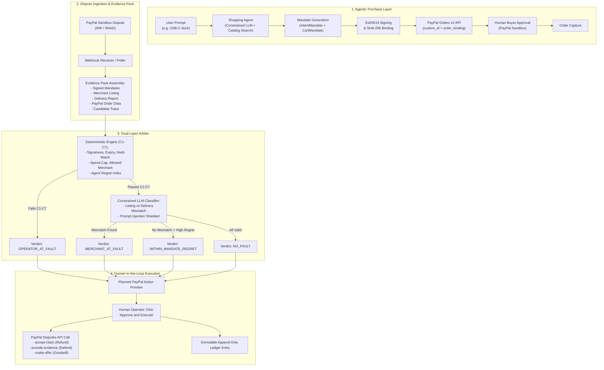

# AgentCourt

> *"AP2 tells you what was authorized. AgentCourt tells you who pays when it goes wrong."*

**AgentCourt** is the post-payment liability resolution layer for autonomous agentic commerce, built for the **PayPal AI Hackathon 2026**.

When an AI shopping agent buys something on behalf of a user and it goes wrong, who is liable? Today's agent-payment protocols (like Google's AP2 mandates) record buyer intent and spend caps, but when an agent hallucinates, suffers price drift, accepts suboptimal offers, or receives mismatched merchandise, the liability question is left unresolved.

AgentCourt bridges this gap:
1. **At checkout**: Binds an AP2-inspired signed intent and cart mandate to the PayPal sandbox order (`custom_id`).
2. **At dispute**: Automatically ingests PayPal customer disputes, compiles a cryptographic evidence pack (mandate vs. merchant listing vs. delivery report vs. candidate trace), and computes deterministic liability checks and agent regret metrics.
3. **Execution**: Presents the human merchant operator with an actionable liability verdict and request preview, executing standard settlement actions through the PayPal Disputes API (`accept-claim`, `provide-evidence`, or `make-offer`).

---

## Creation Date & License

- **Project Created**: 9 November 2026 (during the PayPal AI Hackathon)
- **License**: MIT License (see [LICENSE](file:///LICENSE))

---

## Real vs. Simulated Boundaries

In full adherence to hackathon integrity, AgentCourt maintains an honest distinction between real systems and simulated components:

| Component | Status | Details |
|---|---|---|
| **PayPal Orders v2** | **REAL** | Real PayPal Sandbox API calls (`POST /v2/checkout/orders`, `capture`) with `custom_id` hash binding. |
| **PayPal Disputes API** | **REAL** | Real PayPal Sandbox Customer Disputes API lifecycle (`create`, `show`, `accept-claim`, `provide-evidence`, `make-offer`, `escalate`, `require-evidence`, `adjudicate`). |
| **PayPal Webhook Verification** | **REAL** | Cryptographic verification via `/v1/notifications/verify-webhook-signature`. |
| **Refunds Fallback Settlement** | **REAL** | Settle disputes via `/v2/payments/captures/{id}/refund` if dispute creation is gated. |
| **Deterministic Arbiter** | **REAL** | Pure-function checks (C1–C7) validating Ed25519 signatures, spend caps, hashes, and candidate regret. |
| **Constrained LLM Reasoning** | **REAL** | Schema-validated semantic comparison between signed listings and delivery reports. Cannot override deterministic rule failures. |
| **Merchant Catalog** | *Simulated* | Fictional merchants (`data/merchants.json`) providing USB-C docking stations. |
| **Delivery Reports** | *Simulated* | Mocked warehouse delivery inspections representing what the buyer actually received. |
| **Sandbox Buyer Simulator** | *Simulated* | Issues buyer dispute requests with `PayPal-Auth-Assertion` unsigned JWTs in the sandbox. |

---

## Architecture Diagram



---

## Quick Start (Local Setup in under 5 minutes)

### Prerequisites
- Python 3.12+ (or Python 3.13)
- Node.js 20+
- A PayPal Developer Sandbox account ([developer.paypal.com](https://developer.paypal.com))

### 1. Clone & Configure
```bash
git clone https://github.com/livai12/agentcourt.git
cd agentcourt
cp .env.example .env
```

Edit `.env` with your Sandbox credentials:
```ini
PAYPAL_ENV=sandbox
PAYPAL_CLIENT_ID=your_sandbox_client_id
PAYPAL_CLIENT_SECRET=your_sandbox_client_secret
PAYPAL_MERCHANT_EMAIL=your_sandbox_business_email@business.example.com
PAYPAL_BUYER_EMAIL=your_sandbox_personal_email@personal.example.com
PAYPAL_BUYER_PASSWORD=your_sandbox_buyer_password
```

### 2. Verify Pre-flight Safety Check
```bash
python scripts/check_env.py
```

### 3. Run Offline Evaluation Harness (15 Scenarios)
```bash
python eval/run_eval.py
```

### 4. Run Unit Tests (Mocked Sandbox Endpoints)
```bash
pytest backend/tests/ -v
```

### 5. Run Locally
```bash
# Seed demo cases for initial state
python scripts/seed_demo.py

# Terminal 1: Backend API
uvicorn backend.agentcourt.api.main:app --reload --port 8000

# Terminal 2: Web UI
cd web
npm install
npm run dev
```

Visit `http://localhost:5173` to explore the dashboard.

---

## 15-Scenario Evaluation Harness Results

AgentCourt includes a rigorous 15-scenario evaluation test suite (`eval/run_eval.py`) validating all baseline, breach, security, and edge-case paths:

| ID | Scenario | Category | Expected Verdict | Actual Verdict | Status |
|:---|:---|:---|:---|:---|:---:|
| `SCENARIO_01_VAL` | Valid Purchase & Compliance | Baseline | `NO_FAULT` | `NO_FAULT` | **PASS** |
| `SCENARIO_02_ATT` | Merchant Attribute Mismatch (Delivered 6 ports instead of 10) | Merchant Breach | `MERCHANT_AT_FAULT` | `MERCHANT_AT_FAULT` | **PASS** |
| `SCENARIO_03_PRI` | Price Drift: Captured Total Exceeds Signed Cart | Operator Breach | `OPERATOR_AT_FAULT` | `OPERATOR_AT_FAULT` | **PASS** |
| `SCENARIO_04_SPE` | Spend Cap Breach: Captured Amount Exceeds Authorized Cap | Operator Breach | `OPERATOR_AT_FAULT` | `OPERATOR_AT_FAULT` | **PASS** |
| `SCENARIO_05_TAM` | Tampered Mandate Signature | Operator Breach | `OPERATOR_AT_FAULT` | `OPERATOR_AT_FAULT` | **PASS** |
| `SCENARIO_06_EXP` | Expired Mandate Execution | Operator Breach | `OPERATOR_AT_FAULT` | `OPERATOR_AT_FAULT` | **PASS** |
| `SCENARIO_07_UNL` | Cart Unlinked From Intent Hash | Operator Breach | `OPERATOR_AT_FAULT` | `OPERATOR_AT_FAULT` | **PASS** |
| `SCENARIO_08_REP` | Replayed Mandate onto Foreign Order (C4 Binding Mismatch) | Operator Breach | `OPERATOR_AT_FAULT` | `OPERATOR_AT_FAULT` | **PASS** |
| `SCENARIO_09_UNA` | Agent Purchased from Unauthorized Merchant | Operator Breach | `OPERATOR_AT_FAULT` | `OPERATOR_AT_FAULT` | **PASS** |
| `SCENARIO_10_CAR` | Cart Attributes Violate Intent Constraints | Operator Breach | `OPERATOR_AT_FAULT` | `OPERATOR_AT_FAULT` | **PASS** |
| `SCENARIO_11_REG` | Agent Suboptimal Choice: Regret (28%) > 15% | Innovation / Regret | `WITHIN_MANDATE_REGRET` | `WITHIN_MANDATE_REGRET` | **PASS** |
| `SCENARIO_12_REG` | Minimal Regret (5% <= 15%): No Fault | Innovation / Regret | `NO_FAULT` | `NO_FAULT` | **PASS** |
| `SCENARIO_13_PRO` | Adversarial Prompt Injection in Listing Shielded | Security / AI Safety | `NO_FAULT` | `NO_FAULT` | **PASS** |
| `SCENARIO_14_UNC` | Unclear / Incomplete Delivery Report | Human Fallback | `NEEDS_HUMAN` | `NEEDS_HUMAN` | **PASS** |
| `SCENARIO_15_MIS` | Missing Candidate Trace (Degraded Gracefully) | Resilience | `NO_FAULT` | `NO_FAULT` | **PASS** |

**Summary**: 15/15 scenarios passed (**100.0% accuracy**).

---

## Academic & Industry References

AgentCourt's mandate specification and threat model draw from foundational research in agentic commerce and verifiable mandates:

1. **Google & PayPal Agent Payment Protocol (AP2)**:
   - *Autonomous Payment Protocol (AP2) Mandate Framework*, Google / PayPal working initiatives (2025–2026).
   - Everest Group Research Note: *Autonomous Agent Payments & Mandate Attributions* (2025).
2. **Multi-Agent Markets & Adversarial Commerce**:
   - Microsoft Research: *Magentic Marketplace: Evaluating Autonomous Agents in Multi-Party Economic Games* (2025).
   - RFC 8785: *JSON Canonicalization Scheme (JCS)* for deterministic JSON signature generation.

---

## Deployment to Render

AgentCourt includes a production-ready `Dockerfile` and `render.yaml` blueprint.

### Deploy Steps:
1. Connect your GitHub repository (`https://github.com/livai12/agentcourt`) to [Render](https://dashboard.render.com).
2. Select **New > Blueprint** and link the repository.
3. Add the following Environment Variables in the Render Dashboard:
   - `PAYPAL_ENV=sandbox`
   - `PAYPAL_CLIENT_ID=...`
   - `PAYPAL_CLIENT_SECRET=...`
   - `PAYPAL_MERCHANT_EMAIL=...`
   - `PAYPAL_BUYER_EMAIL=...`
4. Click **Apply**. Render will automatically build the unified Docker image (Vite frontend served directly by FastAPI static files) and provide a public HTTPS URL.

---

## Documentation

- [Devpost Submission Document](file:///docs/DEVPOST.md)
- [Video Recording Script (< 3 mins)](file:///docs/VIDEO_SCRIPT.md)
- [Architecture & Security Model](file:///docs/ARCHITECTURE.md)
- [System Limitations & Threat Model](file:///docs/LIMITATIONS.md)
- [AI & Sponsor Tools Integration](file:///docs/AI_TOOLS.md)

---

## Sponsor Technologies & Integrations

- **PayPal**: Comprehensive Orders v2, Customer Disputes API lifecycle, Webhooks signature verification, and sandbox simulation assertion headers.
- **Bryntum Scheduler**: High-performance interactive dispute case lifecycle timeline view (with inquiry windows, evidence preparation buffers, and response due-date markers).
- **Render**: One-click cloud deployment via `render.yaml` Docker Blueprint.
- **APIMatic**: API context specification and integration validation (see [AI_TOOLS.md](file:///docs/AI_TOOLS.md)).
