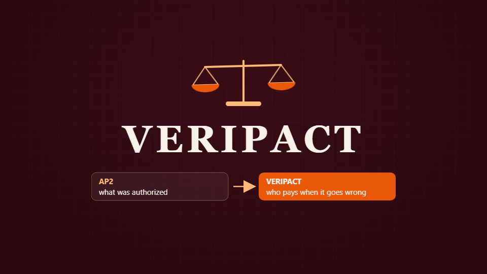
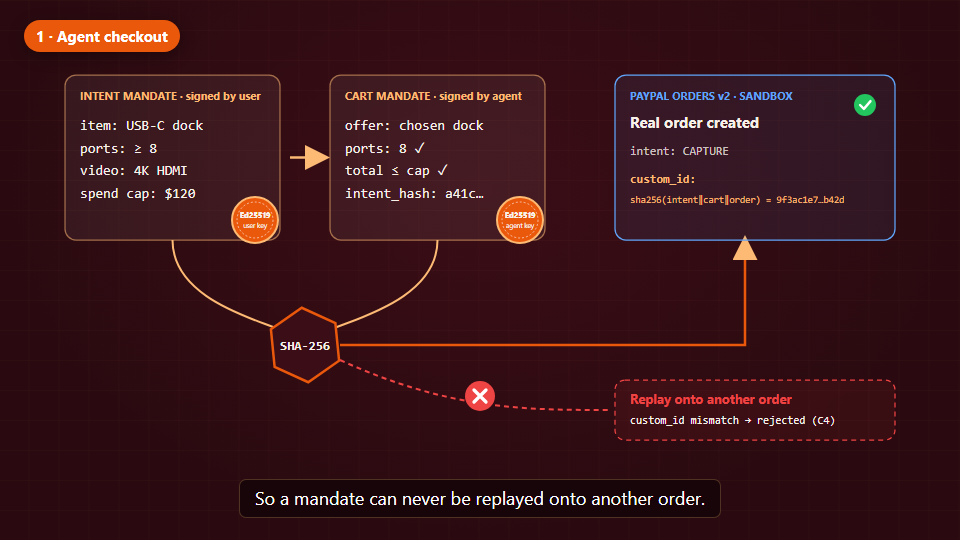
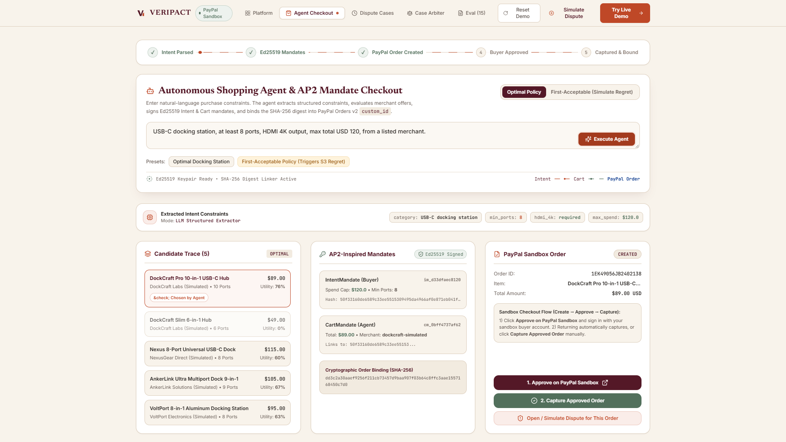
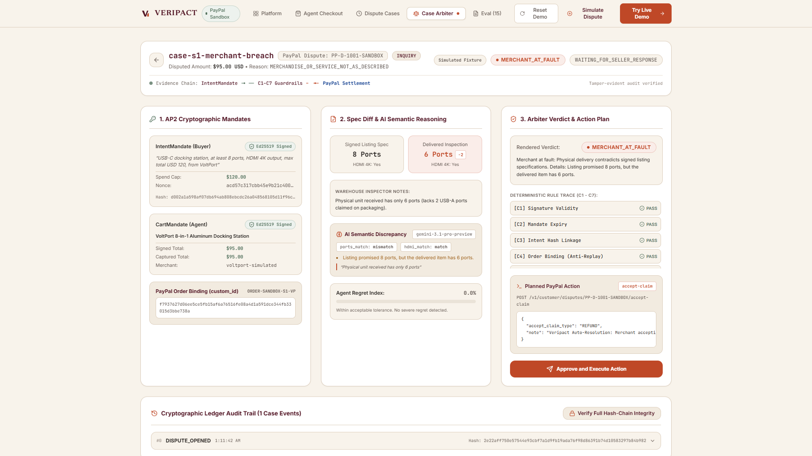
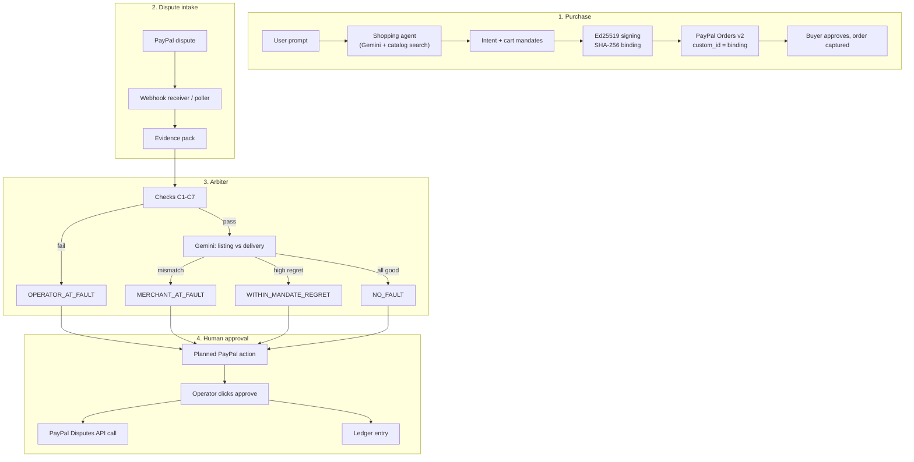

<div align="center">

<a href="https://youtu.be/J3BGgV-0Wx0"></a>

# Veripact

**Your AI agent bought the wrong thing. Who pays?**

[Live demo](https://veripact.onrender.com) · [2-minute video](https://youtu.be/J3BGgV-0Wx0) · [Devpost write-up](docs/DEVPOST.md)


Team Sehari Semalam · PayPal AI Hackathon 2026

</div>

---

## The story in four lines

You ask an agent for a USB-C dock with at least 8 ports, under $120.
It finds one, pays with PayPal, and the box shows up.
The dock has 6 ports.
Now the merchant, the company running the agent, and you all point at each other.

AP2-style mandates record what you authorized. They don't say who's at fault when the purchase goes wrong. Veripact does.

## How it works

**1. Checkout.** Gemini turns your request into structured constraints. You sign an intent mandate, the agent signs a cart mandate (both Ed25519), and Veripact creates a real PayPal Orders v2 sandbox order. A hash of both mandates goes into the order's `custom_id`, so a mandate can't be reused on a different order.



**2. Dispute.** The buyer opens a PayPal dispute. Veripact receives it through a signature-verified webhook and builds an evidence pack: the signed mandates, the merchant listing, the delivery report, the PayPal order, and the agent's candidate trace.

**3. Verdict.** Seven plain-code checks run first (C1–C7: signatures, expiry, intent hash, order binding, spend cap, allowed merchant, constraints). If those pass, Gemini compares the listing with the delivery report. The model can never overrule a failed check, and text hidden in listings that tries to give it instructions gets ignored.

**4. Action.** Veripact proposes a PayPal Disputes call (`accept-claim`, `provide-evidence` or `make-offer`). Nothing runs until a person clicks approve. Each step is written to a hash-chained ledger.

<table>
<tr>
<td></td>
<td></td>
</tr>
<tr>
<td align="center">Agent checkout with a real sandbox order</td>
<td align="center">Evidence pack, C1–C7 trace and verdict</td>
</tr>
</table>

## Try it in 60 seconds

Open https://veripact.onrender.com. It's on Render's free tier, so the first load can take about 50 seconds.

1. **Purchase**: run the shopping agent. You get signed mandates and a real PayPal sandbox order.
2. **Simulate Dispute**: pick "S1: Port Mismatch" and file it.
3. **Cases**: see the dispute on the Bryntum timeline and in the AG Grid registry.
4. Open the case for the evidence, the verdict and the planned PayPal action.

## What's real and what's simulated

| Part | Real or simulated | Notes |
|---|---|---|
| PayPal Orders v2 | Real | Sandbox `create` and `capture`, with the `custom_id` binding |
| PayPal Disputes API | Real | `create`, `show`, `accept-claim`, `provide-evidence`, `make-offer`, `escalate`, `require-evidence`, `adjudicate` |
| Webhook verification | Real | `/v1/notifications/verify-webhook-signature` |
| Refund fallback | Real | `/v2/payments/captures/{id}/refund` when dispute creation is blocked in the sandbox |
| Arbiter checks C1–C7 | Real | Pure functions over signatures, caps, hashes and regret |
| Gemini comparison | Real | Schema-validated output; can't override a failed check |
| Merchant catalog | Simulated | Made-up dock sellers in `data/merchants.json` |
| Delivery reports | Simulated | Stand-ins for what the buyer actually received |
| Buyer simulator | Simulated | Files sandbox disputes with `PayPal-Auth-Assertion` headers |

## Architecture



More detail in [ARCHITECTURE.md](docs/ARCHITECTURE.md) and [LIMITATIONS.md](docs/LIMITATIONS.md).

## Run it locally

You need Python 3.12+, Node 20+ and a [PayPal developer sandbox](https://developer.paypal.com) account.

```bash
git clone https://github.com/Rkaaaa404/veripact.git
cd veripact
cp .env.example .env
```

Fill in `.env`:

```ini
PAYPAL_ENV=sandbox
PAYPAL_CLIENT_ID=your_sandbox_client_id
PAYPAL_CLIENT_SECRET=your_sandbox_client_secret
PAYPAL_MERCHANT_EMAIL=your_sandbox_business_email@business.example.com
PAYPAL_BUYER_EMAIL=your_sandbox_personal_email@personal.example.com
PAYPAL_BUYER_PASSWORD=your_sandbox_buyer_password
LLM_PROVIDER=gemini
LLM_MODEL=gemini-3.1-pro-preview
LLM_API_KEY=your_google_ai_studio_key   # optional; without it only the C1-C7 checks run
```

Then:

```bash
python scripts/check_env.py      # sanity-check your config
python eval/run_eval.py          # 15 offline scenarios
pytest backend/tests/ -v         # unit tests, PayPal calls mocked

python scripts/seed_demo.py      # demo cases
uvicorn backend.veripact.api.main:app --reload --port 8000

# second terminal
cd web && npm install && npm run dev
```

Open http://localhost:5173.

## The 15 test scenarios

`eval/run_eval.py` throws 15 cases at the arbiter. All 15 pass.

| # | Scenario | Expected verdict | Result |
|:--|:--|:--|:-:|
| 01 | Valid purchase | `NO_FAULT` | pass |
| 02 | Delivered 6 ports instead of 10 | `MERCHANT_AT_FAULT` | pass |
| 03 | Captured total higher than signed cart | `OPERATOR_AT_FAULT` | pass |
| 04 | Captured amount over the spend cap | `OPERATOR_AT_FAULT` | pass |
| 05 | Tampered mandate signature | `OPERATOR_AT_FAULT` | pass |
| 06 | Expired mandate | `OPERATOR_AT_FAULT` | pass |
| 07 | Cart not linked to the intent hash | `OPERATOR_AT_FAULT` | pass |
| 08 | Mandate replayed onto another order | `OPERATOR_AT_FAULT` | pass |
| 09 | Unauthorized merchant | `OPERATOR_AT_FAULT` | pass |
| 10 | Cart breaks the intent constraints | `OPERATOR_AT_FAULT` | pass |
| 11 | Agent picked a worse deal (28% regret) | `WITHIN_MANDATE_REGRET` | pass |
| 12 | Small regret (5%) | `NO_FAULT` | pass |
| 13 | Prompt injection hidden in a listing | `NO_FAULT` | pass |
| 14 | Unclear delivery report | `NEEDS_HUMAN` | pass |
| 15 | Missing candidate trace | `NO_FAULT` | pass |

## Deploy your own on Render

The repo ships a `Dockerfile` and a `render.yaml` blueprint. One container serves both the FastAPI backend and the built Vite frontend.

1. In [Render](https://dashboard.render.com), choose **New > Blueprint** and point it at this repo.
2. Set `PAYPAL_CLIENT_ID`, `PAYPAL_CLIENT_SECRET`, `PAYPAL_MERCHANT_EMAIL`, `PAYPAL_BUYER_EMAIL` and `LLM_API_KEY` (a Google AI Studio key). The Gemini provider and model are already set in `render.yaml`.
3. Click **Apply**.

## Built with

- **PayPal**: Orders v2, the Disputes API, webhook signature verification, and sandbox auth-assertion headers
- **Google Gemini 3.1 Pro**: request parsing and listing-vs-delivery comparison
- **Bryntum Scheduler**: the dispute timeline, with inquiry windows, evidence prep and response deadlines
- **AG Grid**: the case registry and eval matrix (`ag-grid-react`)
- **Render**: hosting
- FastAPI, React and Vite

APIMatic's PayPal plugin wasn't used in this build. [AI_TOOLS.md](docs/AI_TOOLS.md) lists every AI tool we used and what for.

## Background reading

- Google, [Agent Payments Protocol (AP2)](https://github.com/google-agentic-commerce/AP2), 2025
- Microsoft Research, *Magentic Marketplace*, 2025: a testbed for agents buying and selling against each other
- [RFC 8785](https://www.rfc-editor.org/rfc/rfc8785), JSON Canonicalization Scheme, which we use to sign mandates deterministically

## Docs

[Devpost write-up](docs/DEVPOST.md) · [Architecture](docs/ARCHITECTURE.md) · [Limitations](docs/LIMITATIONS.md) · [AI tools](docs/AI_TOOLS.md) · [Video script](docs/VIDEO_SCRIPT.md)

---

Started 9 November 2026 during the PayPal AI Hackathon. MIT licensed, see [LICENSE](LICENSE).
