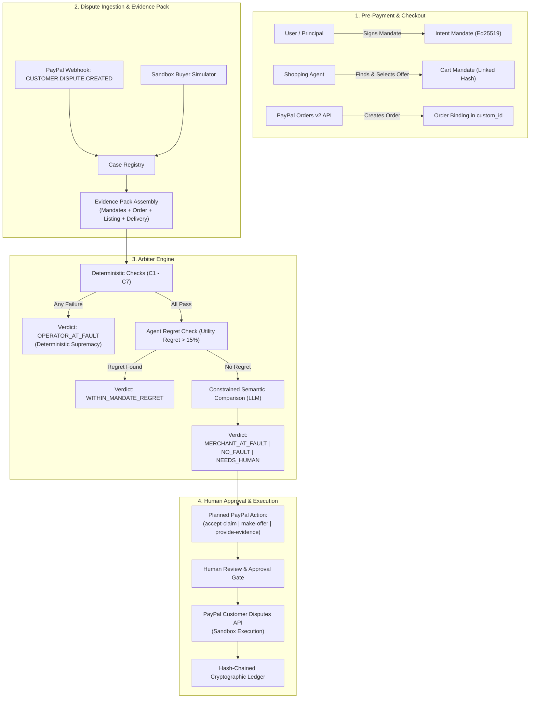

# AgentCourt Architecture & Security Model

## 1. System Overview

AgentCourt provides an end-to-end post-payment liability resolution pipeline for agentic transactions made via PayPal.

---

## 2. Cryptographic Security Model

### 2.1 Canonical Serialization (RFC 8785)
All mandates (Intent Mandate and Cart Mandate) are serialized using strictly canonical JSON:
- Keys are sorted lexicographically in Unicode code point order.
- No superfluous whitespace.
- Numbers are formatted deterministically (fixed 2 decimal places for financial amounts).
- SHA-256 digests are computed directly over canonical UTF-8 bytes.

### 2.2 Asymmetric Digital Signatures
- **Algorithm**: Ed25519 (`cryptography.hazmat.primitives.asymmetric.ed25519`).
- Users hold an Ed25519 private key.
- Intent Mandates are digitally signed by the user (`user_signature`).
- Cart Mandates are digitally signed by the shopping agent (`agent_signature`).

### 2.3 Order Binding & Replay Prevention
To prevent a valid mandate pack from being replayed onto a foreign or unauthorized PayPal transaction:
$$\text{order\_binding} = \text{SHA-256}(\text{intent\_mandate\_hash} \parallel \text{cart\_mandate\_hash} \parallel \text{paypal\_order\_id})$$
This 64-character hex digest is passed to PayPal Orders v2 in `purchase_units[0].custom_id` and verified during dispute arbitration (Check C4).

---

## 3. The 7 Deterministic Checks (C1–C7)

| Rule | Description | Target Breach |
|---|---|---|
| **C1** | **Mandate Integrity** | Verifies Intent and Cart SHA-256 hashes against canonical bytes. |
| **C2** | **Signature Authenticity** | Verifies Ed25519 digital signatures with public keys. |
| **C3** | **Time Validity** | Ensures PayPal capture occurred before `expires_at`. |
| **C4** | **Order Binding Match** | Matches PayPal `custom_id` against `sha256(intent || cart || order_id)`. |
| **C5** | **Spend Cap Enforcement** | Confirms captured total does not exceed user's authorized `max_total_amount`. |
| **C6** | **Merchant Authorization** | Verifies merchant is explicitly allowed if `allowed_merchants` was set. |
| **C7** | **Mandate Hierarchy** | Verifies `cart_mandate.intent_mandate_hash == intent_mandate.intent_hash`. |

### Deterministic Supremacy
If any check C1–C7 evaluates to `False`, the Arbiter immediately outputs:
- `verdict = OPERATOR_AT_FAULT`
- `llm_used = False`
The LLM is completely bypassed, guaranteeing that prompt injections or probabilistic hallucinations cannot exonerate a protocol or operator violation.

---

## 4. Autonomous Agent Regret Metric

When an autonomous agent shops across multiple merchants, it generates candidate evaluation traces:
$$\text{Relative Regret} = \frac{U_{\text{optimal}} - U_{\text{chosen}}}{U_{\text{optimal}}}$$
- If the agent used an unconstrained `OPTIMAL` policy, regret is 0%.
- If the agent used a `FIRST_ACCEPTABLE` policy or made an inferior selection resulting in $\text{Regret} > 15\%$, AgentCourt classifies the dispute as `WITHIN_MANDATE_REGRET`.
- **Remedy**: Rather than forcing a merchant chargeback or penalizing the merchant, AgentCourt generates a goodwill customer remedy (`make-offer`).

---

## 5. Cryptographic Ledger & Audit Trail

The internal ledger (`backend/agentcourt/ledger/ledger.py`) implements a tamper-evident hash chain:
$$\text{Hash}_0 = \text{SHA-256}(\text{Genesis})$$
$$\text{Hash}_i = \text{SHA-256}(\text{Index}_i \parallel \text{Timestamp}_i \parallel \text{EventType}_i \parallel \text{PayloadHash}_i \parallel \text{Hash}_{i-1})$$
Any retroactive modification of ledger events invalidates the chain integrity check (`verify_integrity() -> False`).

